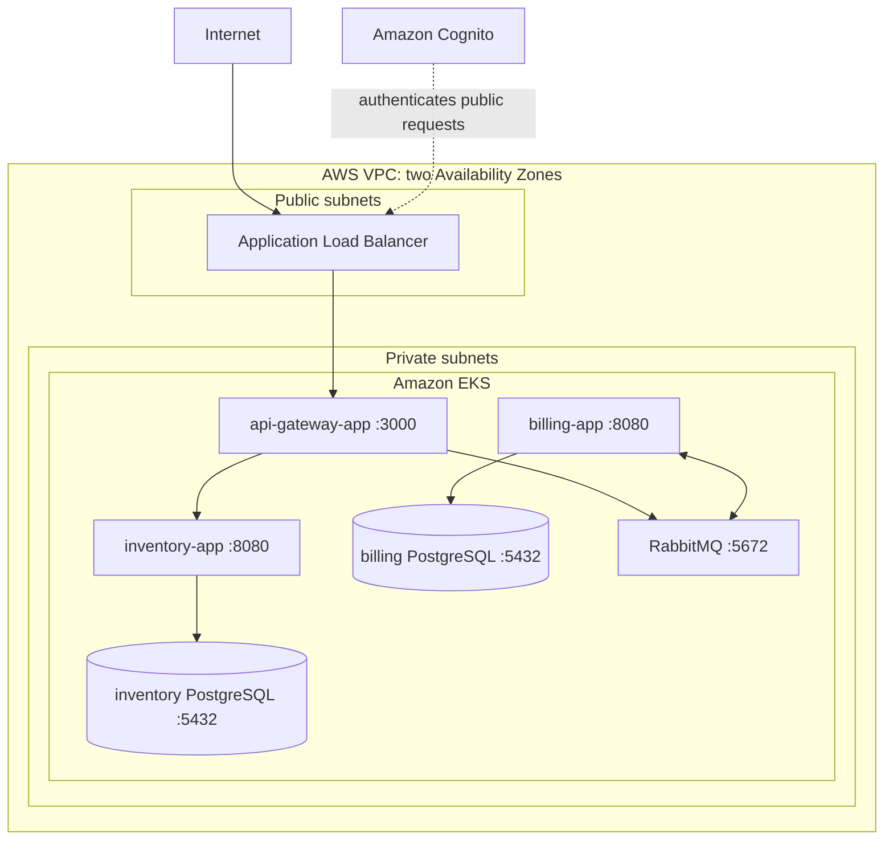

# Cloud Design

Infrastructure-as-code design for deploying the [01-edu orchestrator](https://github.com/01-edu/orchestrator) microservices application to AWS. The application is developed and verified locally first; Terraform describes the AWS environment that will later host it.

## Architecture

The initial AWS implementation preserves the supplied Kubernetes workload model. All six application components run in Amazon EKS. PostgreSQL and RabbitMQ use persistent volumes backed by Amazon EBS and remain private to the cluster.



Only the Application Load Balancer accepts internet traffic. Kubernetes Services provide private communication between the gateway, applications, databases, and RabbitMQ. Databases and the queue have no public IP addresses or public load balancers.

## Application Components

| Component         | Port | Responsibility                                                                 |
| ----------------- | ---- | ------------------------------------------------------------------------------ |
| `api-gateway-app` | 3000 | Public entry point; forwards inventory requests and publishes billing messages |
| `inventory-app`   | 8080 | Inventory API; connects to `inventory-db`                                      |
| `billing-app`     | 8080 | Consumes billing messages; connects to `billing-db`                            |
| `inventory-db`    | 5432 | PostgreSQL data store for inventory                                            |
| `billing-db`      | 5432 | PostgreSQL data store for billing                                              |
| `billing-queue`   | 5672 | RabbitMQ message broker for billing work                                       |

The supplied manifests already define Horizontal Pod Autoscalers for `api-gateway-app` and `inventory-app`, with one to three replicas at a 60% CPU target. EKS metrics support will be configured before these autoscalers are used in AWS.

## Repository Layout

```text
docs/                  Project brief and audit requirements
terraform/             AWS infrastructure configuration
  versions.tf          Terraform and provider version constraints
  provider.tf          AWS provider and common resource tags
  variables.tf         Environment inputs and validation
  locals.tf            Naming convention and shared tags
  network.tf           VPC, subnets, internet gateway, NAT gateway, and routes
  security.tf          Security groups and ingress/egress rules
  ecr.tf               Private application image repositories and retention rules
  eks.tf               EKS control plane, managed node group, IAM roles, and node template
  certificate.tf       ACM certificate and Route 53 DNS validation record
  cognito.tf           Cognito user pool, ALB client, and hosted domain
  load-balancer-controller.tf  ALB controller IAM role and Helm release
  logging.tf           CloudWatch log groups and Fluent Bit log forwarding
  monitoring.tf        Metrics Server Helm release for HPA CPU metrics
  secrets.tf           Kubernetes application Secret
  secrets.tfvars.example  Placeholder-only secret input template
  outputs.tf           Network IDs for later infrastructure components
kubernetes/
  base/                Portable orchestrator workload manifests
scripts/
  mirror-images.sh     Mirrors the three provided application images into ECR
```

The reference application is currently cloned separately at `/home/eb/scripts/reboot/devops/orchestrator-cd`. Its Kubernetes manifests are the source model for the future EKS deployment.

The copied `kubernetes/base/` manifests preserve the six workload components and their private service DNS names. All Services, including `api-gateway-app`, are `ClusterIP`: a Terraform-managed Ingress will later define the only public entry point. The base intentionally contains no credentials, AWS annotations, ECR image references, or storage-class choice. It references an `orchestrator-secrets` Secret that Terraform will later manage from an ignored local input or synchronize from AWS Secrets Manager.

## Prerequisites

For local validation:

- Terraform 1.15.x
- Internet access to download Terraform providers on first initialization

For local application testing:

- The orchestrator project's prerequisites: Vagrant, VirtualBox, Docker, and `kubectl`

For a future AWS deployment:

- AWS account and AWS CLI credentials
- An AWS CLI profile with permission to create the documented resources
- `kubectl`
- Docker and access to push application images to Amazon ECR

## Terraform Usage

Run Terraform commands from the `terraform/` directory.

```sh
terraform fmt -check -recursive
terraform init -backend=false
terraform validate
kubectl kustomize ../kubernetes/base
```

```sh
cp terraform/terraform.tfvars.example terraform/terraform.tfvars
```

It selects a region, environment, EKS version, trusted API CIDR, and Route 53 zone:

```hcl
aws_region  = "eu-west-3"
environment = "dev"
kubernetes_version    = "1.34"
eks_api_allowed_cidrs = ["203.0.113.10/32"]
route53_zone_name     = "example.com"
api_subdomain         = "api"
cognito_domain_prefix = "replace-with-a-globally-unique-prefix"
cloudwatch_log_retention_days          = 30
aws_for_fluent_bit_chart_version       = "replace-with-a-compatible-version"
metrics_server_chart_version           = "replace-with-a-compatible-version"
cluster_autoscaler_chart_version       = "replace-with-a-compatible-version"
```

Replace `203.0.113.10/32` with your own public IP followed by `/32`.

Terraform uses the standard AWS credential chain. Select an AWS CLI profile with `AWS_PROFILE=cloud-design` before running Terraform, or use the default configured credentials.

`terraform/*.tfvars`, state files, and Terraform's plugin directory are excluded from Git. The provider lock file is committed so collaborators use the same provider version.

Create the ignored secret input file before a real deployment:

```sh
cp terraform/secrets.tfvars.example terraform/secrets.tfvars
```

Replace every `replace-me` value, then supply it only through `-var-file=secrets.tfvars` when running Terraform.

## Deployment Order

This sequence describes a real AWS deployment. It has not been run in this project.

- Configure AWS CLI, Docker, Terraform, `kubectl`, `terraform.tfvars`, and ignored `secrets.tfvars`.
- Review `terraform plan -var-file=secrets.tfvars`.
- Then run `terraform apply -var-file=secrets.tfvars`.
- Optionally mirror application images to ECR with `./scripts/mirror-images.sh release-001`.
- Deploy the supplied workloads with `kubectl apply -k kubernetes/base`.
- Verify pods, PVCs, ALB targets, logs, DNS, node scaling, and `https://api.<domain>`.
- Delete temporary infrastructure with `terraform destroy -var-file=secrets.tfvars` and manually remove retained EBS volumes when no longer needed.

## Design Decisions

### EKS

EKS is selected because the reference project is already expressed as Kubernetes manifests. This preserves Kubernetes services, deployments, StatefulSets, persistent volume claims, and horizontal autoscaling rather than translating the application into a different orchestration model.

Terraform defines an EKS control plane in the private subnets, with API and audit logs sent to CloudWatch. A managed node group initially runs two on-demand `t3.medium` nodes, one in each Availability Zone. Nodes have encrypted `gp3` root volumes, require IMDSv2, and use narrowly scoped IAM policies for EKS operation and private ECR image pulls.

The Kubernetes API has both private and public endpoints. The public endpoint is restricted to the required `eks_api_allowed_cidrs` input; set this to trusted administrator IP addresses only, never `0.0.0.0/0`. The Kubernetes version is also required input, so a deployment explicitly selects an EKS version AWS supports at that time.

### Scaling and Availability

- EKS nodes span two Availability Zones.
- The ALB distributes public traffic across API gateway replicas.
- Metrics Server supplies CPU metrics to the gateway and inventory app HPAs, which scale from one to three replicas at 60% CPU.
- Cluster Autoscaler increases the managed node group from two to at most three nodes when HPA-created pods cannot be scheduled, and reduces it when that capacity is no longer needed.
- Current limitations are one NAT gateway and single-replica PostgreSQL and RabbitMQ workloads.

### Stateful Workloads

For this implementation, both PostgreSQL databases and RabbitMQ remain Kubernetes StatefulSets in EKS with EBS-backed persistent volumes. This directly reflects the project requirements and limits the first AWS implementation to one orchestration model.

Terraform creates a default `gp3` EBS StorageClass, so the base PVCs select it without AWS-specific manifest patches. The EKS EBS CSI add-on dynamically creates an encrypted EBS volume when a pod is scheduled. Its `WaitForFirstConsumer` binding mode creates the volume in the pod's Availability Zone, preventing cross-AZ attachment failures. The CSI controller uses an IAM role bound only to its Kubernetes service account through EKS OIDC.

The `gp3` StorageClass uses a `Retain` reclaim policy: deleting a PVC does not delete its dynamically provisioned EBS volume. This preserves data for inspection or recovery, but retained volumes continue to incur cost and must be deleted manually when no longer needed.

The documented production alternative is Amazon RDS for PostgreSQL and Amazon MQ for RabbitMQ. Managed services reduce operational work and can improve availability, backups, patching, and recovery, but require additional configuration and alter the supplied Kubernetes deployment.

### Networking

The VPC spans `eu-west-3a` and `eu-west-3b`, with a `/16` VPC CIDR. Public load-balancer subnets use `10.0.0.0/24` and `10.0.1.0/24`; private EKS subnets use `10.0.16.0/20` and `10.0.32.0/20`. These values are configurable Terraform inputs.

The public route table sends internet-bound traffic to an Internet Gateway. Both private subnets instead use one NAT gateway in the first public subnet, allowing private workloads to pull images and receive updates without accepting unsolicited inbound internet traffic. A single NAT gateway is an intentional development cost trade-off and a single-AZ failure point. A production environment should use a NAT gateway per Availability Zone or use VPC endpoints for supported AWS services.

Public subnets are tagged for the AWS Load Balancer Controller to discover them when it creates internet-facing ALBs. Private subnets are separately tagged for internal ALBs. The controller is installed through a pinned Helm chart and has an IAM role bound only to its `kube-system/aws-load-balancer-controller` service account through EKS OIDC. Its permissions are the AWS-recommended policy for controller v2.14.1, stored in this repository for review and reproducibility.

Terraform looks up the existing public Route 53 hosted zone named by `route53_zone_name`, requests an ACM certificate for `api.<zone>`, and creates ACM's DNS validation record in that zone. The certificate is issued in the same region as the future ALB and its ARN will be passed to the HTTPS Ingress in the next step.

Terraform manages the `api-gateway` Kubernetes Ingress. The AWS Load Balancer Controller creates an internet-facing ALB in the tagged public subnets, attaches the predefined ALB security group, and registers API gateway pod IPs as targets. HTTP on port `80` redirects to HTTPS on `443`, which uses the ACM certificate. Terraform waits for the ALB, looks it up by its deterministic name, and creates the `api.<zone>` Route 53 alias record. The `api-gateway-app` Service must be deployed before the controller can register healthy targets.

### Container Images

ECR repositories are defined for the three application images: `api-gateway-app`, `inventory-app`, and `billing-app`. Each repository is private, encrypted at rest, and configured with immutable tags. Amazon Inspector is enabled for ECR and continuously scans images in this project's repositories for operating-system and language-package vulnerabilities, including when new relevant CVEs are published. Review findings in Amazon Inspector or ECR before deploying an image; enhanced scanning may incur Amazon Inspector charges.

Untagged images expire after seven days and each repository retains its 20 most recent images. This limits registry storage costs while retaining a practical rollback window. PostgreSQL and RabbitMQ are stateful dependencies; their image sourcing will be documented when their EKS deployment is adapted.

The provided application images can be mirrored into the Terraform-created ECR repositories with a shared immutable release tag:

```sh
./scripts/mirror-images.sh release-001
```

The script requires Docker, AWS CLI credentials, `jq`, and Terraform state from an applied ECR configuration. It pulls the three `ghcr.io/01-edu` application images, tags each with the supplied release tag, pushes them to ECR, and prints the source and ECR digests. It does not build images, push stateful dependency images, or alter the Kubernetes deployment.

### Security Boundaries

- Internet traffic reaches only the ALB on ports `80` and `443`; port `80` redirects to HTTPS.
- The ALB reaches only `api-gateway-app` on port `3000`.
- The gateway, applications, databases, and RabbitMQ communicate through private Kubernetes Services (this can be hardened with NetworkPolicies to restrict service to service access).
- PostgreSQL and RabbitMQ have no public endpoint.
- Cognito authenticates public API requests at the ALB before they reach the gateway.
- NetworkPolicies and AWS Secrets Manager synchronization remain planned controls.

## Logging and Monitoring

- EKS API, audit, authenticator, controller manager, and scheduler logs use the retained CloudWatch control-plane log group.
- Fluent Bit forwards container stdout and stderr to the retained application CloudWatch log group using an OIDC-bound IAM role.
- Metrics Server supplies resource metrics to Kubernetes HPAs.
- CloudWatch dashboards and alarms provide the operational view without deploying a separate Prometheus or Grafana stack.
- Replace all chart-version placeholders in `terraform.tfvars` with versions compatible with the chosen EKS Kubernetes version.

## Cost Management

EKS, load balancers, NAT gateways, EC2 worker nodes, EBS volumes, and data transfer can incur costs even at low traffic. Before applying this configuration to a real account:

- Configure an AWS Budget and billing alerts.
- Use a dedicated `dev` environment with minimal node and storage sizes.
- Review `terraform plan` before every apply.
- Destroy temporary environments with `terraform destroy` when finished.
- Remove unused container images, volumes, and load balancers.
