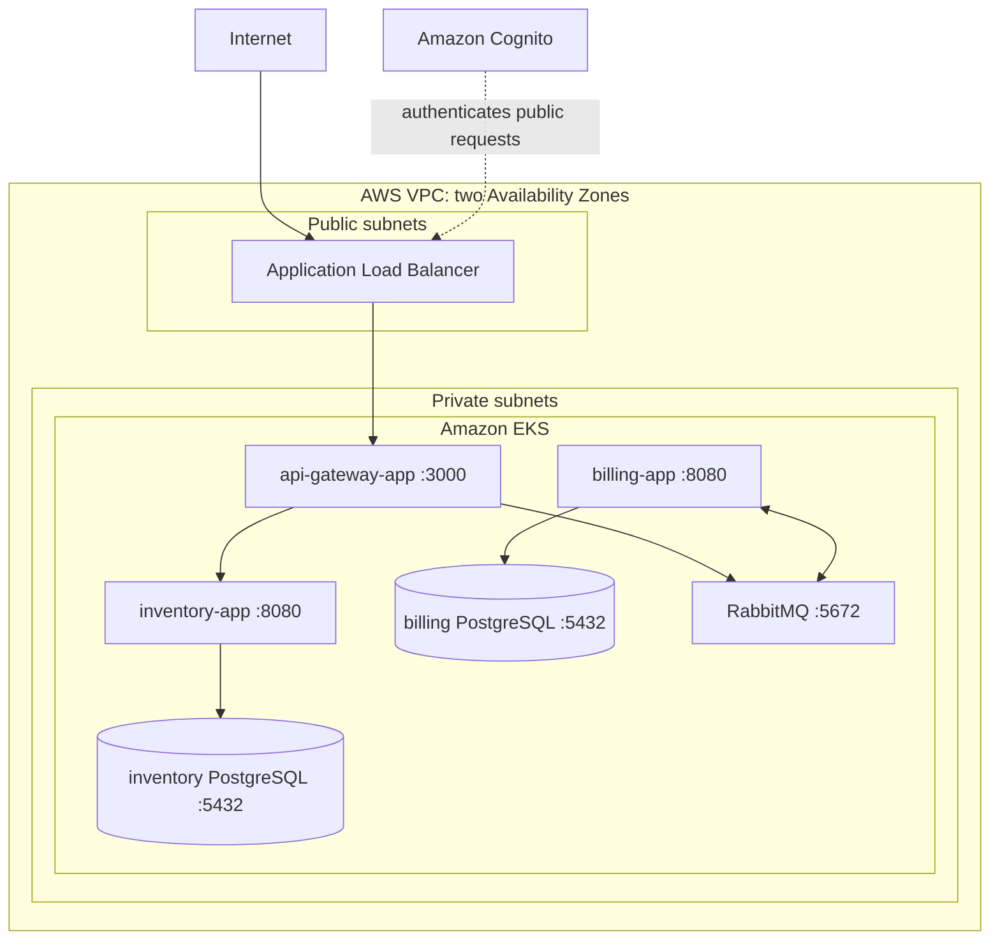

# Cloud Design

Infrastructure-as-code design for deploying the [01-edu orchestrator](https://github.com/01-edu/orchestrator) microservices application to AWS. The application is developed and verified locally first; Terraform describes the AWS environment that will later host it.

## Status

The Terraform root configuration is complete and validates locally. AWS resources have not yet been provisioned because this project is being developed without an AWS account.

| Area | Status |
| --- | --- |
| Local Kubernetes application | Assumed working from the supplied orchestrator project |
| Terraform provider and inputs | Complete |
| VPC and subnet routing | Defined; not provisioned |
| Load balancer and EKS security groups | Defined; not provisioned |
| ECR repositories | Defined; not provisioned |
| EKS control plane and managed node group | Defined; not provisioned |
| Kubernetes base workload manifests | Defined; not deployed |
| EBS CSI driver and AWS storage overlay | Defined; not provisioned |
| AWS Load Balancer Controller | Defined; not provisioned |
| Kubernetes deployment to AWS | Planned |
| Monitoring, logging, autoscaling, and Cognito | Planned |

## Architecture

The initial AWS implementation preserves the supplied Kubernetes workload model. All six application components run in Amazon EKS. PostgreSQL and RabbitMQ use persistent volumes backed by Amazon EBS and remain private to the cluster.



Only the Application Load Balancer accepts internet traffic. Kubernetes Services provide private communication between the gateway, applications, databases, and RabbitMQ. Databases and the queue have no public IP addresses or public load balancers.

## Application Components

| Component | Port | Responsibility |
| --- | --- | --- |
| `api-gateway-app` | 3000 | Public entry point; forwards inventory requests and publishes billing messages |
| `inventory-app` | 8080 | Inventory API; connects to `inventory-db` |
| `billing-app` | 8080 | Consumes billing messages; connects to `billing-db` |
| `inventory-db` | 5432 | PostgreSQL data store for inventory |
| `billing-db` | 5432 | PostgreSQL data store for billing |
| `billing-queue` | 5672 | RabbitMQ message broker for billing work |

The supplied manifests already define Horizontal Pod Autoscalers for `api-gateway-app` and `inventory-app`, with one to three replicas at a 60% CPU target. EKS metrics support will be configured before these autoscalers are used in AWS.

## Repository Layout

```text
docs/                  Project brief and audit requirements
terraform/             AWS infrastructure configuration
  versions.tf          Terraform and provider version constraints
  provider.tf          AWS provider and common resource tags
  variables.tf         Environment inputs and validation
  locals.tf            Naming convention and shared tags
  network.tf           VPC, subnets, internet gateway, NAT gateway, and routes
  security.tf          Security groups and ingress/egress rules
  ecr.tf               Private application image repositories and retention rules
  eks.tf               EKS control plane, managed node group, IAM roles, and node template
  load-balancer-controller.tf  ALB controller IAM role and Helm release
  outputs.tf           Network IDs for later infrastructure components
kubernetes/
  base/                Portable orchestrator workload manifests
  overlays/aws/        EKS storage configuration and future AWS deployment changes
```

The reference application is currently cloned separately at `/home/eb/scripts/reboot/devops/orchestrator-cd`. Its Kubernetes manifests are the source model for the future EKS deployment.

The copied `kubernetes/base/` manifests preserve the six workload components and their private service DNS names. All Services, including `api-gateway-app`, are `ClusterIP`: an AWS-specific overlay will later define an Ingress, which is the only public entry point. The base intentionally contains no credentials, AWS annotations, ECR image references, or storage-class choice. It references an `orchestrator-secrets` Secret that a later overlay will create from an ignored local file or synchronize from AWS Secrets Manager.

## Prerequisites

For local validation:

- Terraform 1.15.x
- Internet access to download Terraform providers on first initialization

For local application testing:

- The orchestrator project's prerequisites: Vagrant, VirtualBox, Docker, and `kubectl`

For a future AWS deployment:

- AWS account and AWS CLI credentials
- An AWS CLI profile with permission to create the documented resources
- `kubectl`
- Docker and access to push application images to Amazon ECR

## Terraform Usage

Run Terraform commands from the `terraform/` directory.

```sh
terraform fmt -check -recursive
terraform init -backend=false
terraform validate
kubectl kustomize ../kubernetes/base
kubectl kustomize ../kubernetes/overlays/aws
```

The current configuration needs no AWS credentials because it defines no AWS resources. Later, use an uncommitted `terraform.tfvars` file to select a region, environment, and optional AWS CLI profile:

```hcl
aws_region  = "eu-west-3"
environment = "dev"
aws_profile = "cloud-design"
kubernetes_version    = "1.34"
eks_api_allowed_cidrs = ["203.0.113.10/32"]
```

`terraform/*.tfvars`, state files, and Terraform's plugin directory are excluded from Git. The provider lock file is committed so collaborators use the same provider version.

## Design Decisions

### EKS

EKS is selected because the reference project is already expressed as Kubernetes manifests. This preserves Kubernetes services, deployments, StatefulSets, persistent volume claims, and horizontal autoscaling rather than translating the application into a different orchestration model.

Terraform defines an EKS control plane in the private subnets, with API and audit logs sent to CloudWatch. A managed node group initially runs two on-demand `t3.medium` nodes, one in each Availability Zone. Nodes have encrypted `gp3` root volumes, require IMDSv2, and use narrowly scoped IAM policies for EKS operation and private ECR image pulls.

The Kubernetes API has both private and public endpoints. The public endpoint is restricted to the required `eks_api_allowed_cidrs` input; set this to trusted administrator IP addresses only, never `0.0.0.0/0`. The Kubernetes version is also required input, so a deployment explicitly selects an EKS version AWS supports at that time.

### Stateful Workloads

For the initial implementation, both PostgreSQL databases and RabbitMQ remain Kubernetes StatefulSets in EKS with EBS-backed persistent volumes. This directly reflects the project requirements and limits the first AWS implementation to one orchestration model.

The AWS overlay assigns their PVCs to a `gp3` EBS StorageClass. The EKS EBS CSI add-on dynamically creates an encrypted EBS volume when a pod is scheduled. Its `WaitForFirstConsumer` binding mode creates the volume in the pod's Availability Zone, preventing cross-AZ attachment failures. The CSI controller uses an IAM role bound only to its Kubernetes service account through EKS OIDC.

The `gp3` StorageClass uses a `Retain` reclaim policy: deleting a PVC does not delete its dynamically provisioned EBS volume. This preserves data for inspection or recovery, but retained volumes continue to incur cost and must be deleted manually when no longer needed.

The documented production alternative is Amazon RDS for PostgreSQL and Amazon MQ for RabbitMQ. Managed services reduce operational work and can improve availability, backups, patching, and recovery, but require additional configuration and alter the supplied Kubernetes deployment.

### Networking

The VPC spans `eu-west-3a` and `eu-west-3b`, with a `/16` VPC CIDR. Public load-balancer subnets use `10.0.0.0/24` and `10.0.1.0/24`; private EKS subnets use `10.0.16.0/20` and `10.0.32.0/20`. These values are configurable Terraform inputs.

The public route table sends internet-bound traffic to an Internet Gateway. Both private subnets instead use one NAT gateway in the first public subnet, allowing private workloads to pull images and receive updates without accepting unsolicited inbound internet traffic. A single NAT gateway is an intentional development cost trade-off and a single-AZ failure point. A production environment should use a NAT gateway per Availability Zone or use VPC endpoints for supported AWS services.

Public subnets are tagged for the AWS Load Balancer Controller to discover them when it creates internet-facing ALBs. Private subnets are separately tagged for internal ALBs. The controller is installed through a pinned Helm chart and has an IAM role bound only to its `kube-system/aws-load-balancer-controller` service account through EKS OIDC. Its permissions are the AWS-recommended policy for controller v2.14.1, stored in this repository for review and reproducibility.

### Container Images

ECR repositories are defined for the three application images: `api-gateway-app`, `inventory-app`, and `billing-app`. Each repository is private, encrypted at rest, scanned on push, and configured with immutable tags. The deployment workflow will build an image, tag it with an immutable release version or commit SHA, push it to ECR, and update the Kubernetes manifest to use that exact image reference.

Untagged images expire after seven days and each repository retains its 20 most recent images. This limits registry storage costs while retaining a practical rollback window. PostgreSQL and RabbitMQ are stateful dependencies; their image sourcing will be documented when their EKS deployment is adapted.

### Security

- TLS will terminate at the ALB using AWS Certificate Manager.
- Cognito will provide managed authentication for the public API.
- The ALB security group accepts ports `80` and `443` from configured public CIDRs. Port `80` will only redirect to HTTPS.
- The ALB can reach EKS only on the API gateway port (`3000`); EKS allows that port only from the ALB security group.
- EKS nodes accept unrestricted traffic only from other EKS nodes; Kubernetes NetworkPolicies will further restrict pod-to-pod traffic.
- Kubernetes Secrets will not be committed. AWS Secrets Manager integration is planned for the deployed environment.
- Node IAM roles have only the baseline EKS, CNI, and ECR-pull policies; IAM roles for service accounts will give Kubernetes controllers narrowly scoped AWS access.
- Network policies will restrict pod-to-pod traffic to required application paths.

## Operations Plan

CloudWatch logging and metrics, Kubernetes readiness and liveness probes, EKS metrics, and the supplied application HPAs will provide the initial operational view. The final deployment will document dashboards, alert thresholds, log retention, load testing, and scaling results.

## Cost Management

EKS, load balancers, NAT gateways, EC2 worker nodes, EBS volumes, and data transfer can incur costs even at low traffic. Before applying this configuration to a real account:

- Configure an AWS Budget and billing alerts.
- Use a dedicated `dev` environment with minimal node and storage sizes.
- Review `terraform plan` before every apply.
- Destroy temporary environments with `terraform destroy` when finished.
- Remove unused container images, volumes, and load balancers.

## Roadmap

1. Create an AWS Ingress overlay for the API gateway.
2. Create AWS Kubernetes overlays for secrets and ECR image locations.
3. Configure TLS, Cognito, logging, monitoring, and autoscaling.
4. Perform load, recovery, security, and cost validation on a real AWS account.
