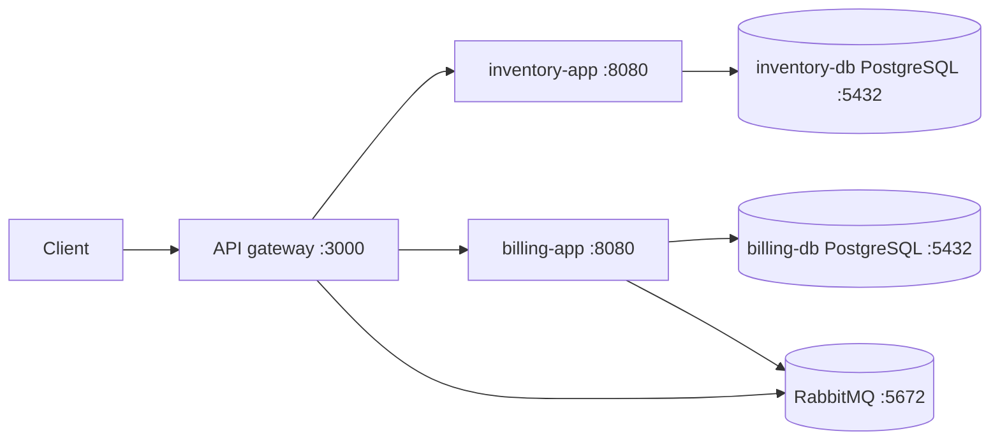
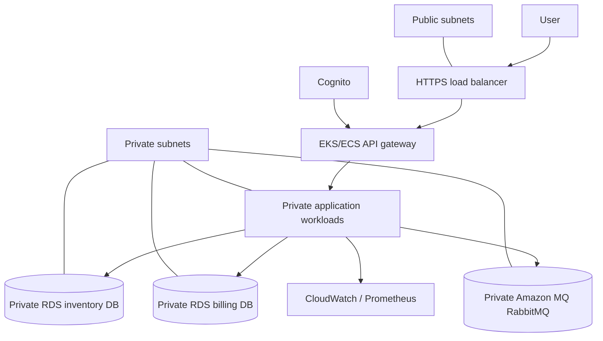

# Architecture

## Demonstrated Local Architecture

The gateway is exposed through the local K3s NodePort. Application services,
databases, and RabbitMQ use Kubernetes Services and are not directly exposed
to the host. The database workloads use StatefulSets and persistent volume
claims. The gateway and inventory app use HPAs with one to three replicas and a
60% CPU target.

## Proposed AWS Architecture

The AWS diagram is a design proposal, not a deployed environment. Terraform is
kept separate from the local K3s implementation so that local evidence does not
get confused with AWS evidence.

## Boundaries

- Public traffic terminates at HTTPS and is authenticated before reaching the
  gateway.
- Only application workloads can reach databases and RabbitMQ.
- Databases and the broker have no public ingress.
- Secrets are supplied by a secret manager in the AWS design and by an ignored
  local file plus generated Kubernetes Secret during local development.
- AWS encryption, IAM, Cognito, CloudWatch, and billing controls require an AWS
  account and remain unverified.
