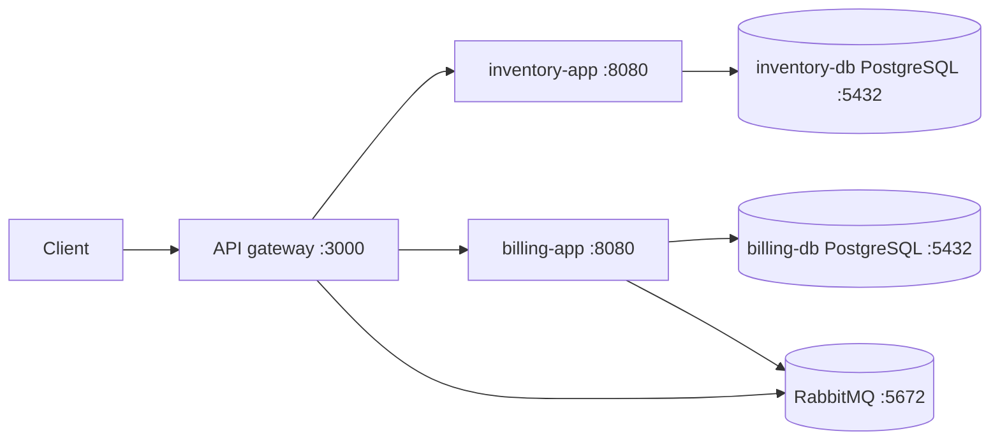
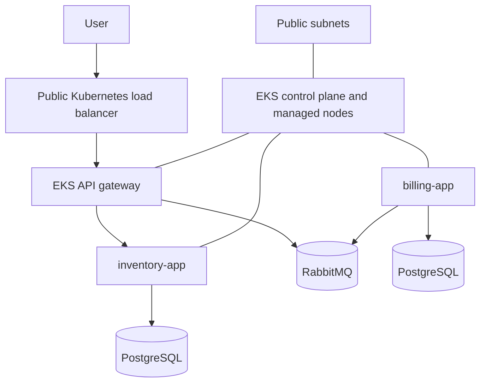

# Architecture

## Demonstrated Local Architecture

The gateway is exposed through the local K3s LoadBalancer Service. Application services,
databases, and RabbitMQ use Kubernetes Services and are not directly exposed
to the host. The database workloads use StatefulSets and persistent volume
claims. The gateway and inventory app use HPAs with one to three replicas and a
60% CPU target.

## Minimal AWS EKS Architecture

Terraform provisions the EKS cluster, networking, EBS CSI add-on, ECR
repositories, `gp3` StorageClass, Metrics Server, and Cluster Autoscaler. The
application resources remain outside Terraform and are deployed with
`kubectl apply -f Manifests`.

## Boundaries

- Public traffic reaches only the gateway through its Kubernetes LoadBalancer
  Service.
- Databases and RabbitMQ remain internal Kubernetes Services.
- EBS CSI dynamically provisions encrypted `gp3` volumes for persistent data.
- Credentials come from an ignored local file and are created as a Kubernetes
  Secret before applying the application manifests.
- This cost-minimized EKS setup has public worker nodes and no HTTPS,
  authentication, managed data services, or centralized AWS observability.
- Metrics Server supplies CPU metrics to the existing HPAs. Cluster Autoscaler
  increases or decreases the managed node group between one and three nodes.
